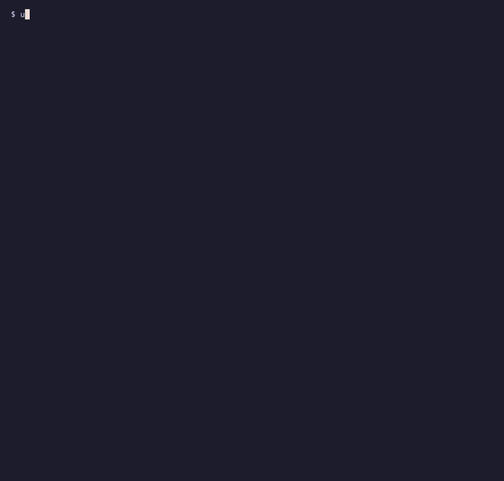

<h1 align="center">
  <picture>
    <source media="(prefers-reduced-motion: reduce)" srcset="assets/logo.png">
    
  </picture>
  <br>
  havoc365
</h1>

<p align="center"><strong>Downtime by appointment.</strong></p>

<p align="center">
  
  
  <a href="LICENSE"></a>
  <br>
  
  
  
</p>

When Microsoft 365 went down on 12 November 2026, people lost access to email, Teams and SharePoint. By the next morning, delayed messages were still arriving. Microsoft had [extended the mail delivery timeout to 48 hours](https://www.bleepingcomputer.com/news/microsoft/massive-microsoft-365-outage-disrupts-outlook-teams-copilot-worldwide/) while it worked through the backlog. Admins trying to find out what was wrong [couldn't reach Intune or the Microsoft 365 Apps Admin Center either](https://www.theregister.com/saas/2026/11/12/microsoft-struggling-to-fix-massive-cloud-outage-thats-taken-down-email-and-intune/5309531).

If your monitoring sends alerts through Exchange, those alerts may be waiting in the same queue. If the incident runbook lives in SharePoint, you may not be able to open it. You need to know about those dependencies before you're trying to work around them during an outage.

havoc365 maps these dependencies in your tenant and runs outage drills with a small group of volunteers.

<picture>
  <source media="(prefers-reduced-motion: reduce)" srcset="assets/map.png">
  
</picture>

*Offline demo using Microsoft Learn examples, not a live tenant. Domains are omitted; no DNS queries are made.*

## Getting Started

You need [uv](https://docs.astral.sh/uv/) and a Microsoft 365 account with the Global Reader role. Drills require the additional roles listed under [Permissions](#permissions).

1. Install havoc365:

   ```sh
   uv tool install git+https://github.com/JGalego/havoc365
   ```

2. [Register an app](https://learn.microsoft.com/entra/identity-platform/quickstart-register-app) in Microsoft Entra. Allow public client flows, add the `map` permissions listed under [Permissions](#permissions), and grant admin consent.

3. Sign in and map your tenant:

   ```sh
   havoc365 login --tenant contoso.onmicrosoft.com --client-id <app-id>
   havoc365 map
   ```

   ```text
   contoso.onmicrosoft.com

   If Exchange Online goes down
     14 identities used SMTP AUTH   alerts@contoso.com, monitoring-prod@contoso.com, scanner@contoso.com, +11
     6 apps request Microsoft Graph Mail.Send   HR Portal, Notifications, Ticketing, +3
     contoso.com has an MX route straight to Exchange   contoso-com.mail.protection.outlook.com

   If SharePoint goes down
     9 runbook search matches in SharePoint   Major Incident.docx, Outage Runbook.docx, Runbook.docx, +6

   If Entra ID sign-in goes down
     47 enabled enterprise apps use Entra ID   Payroll, VPN, Wiki, +44

   Limits and skipped checks
     - SMTP observations cover the last 7 days, not every sender or device.
     - Mail.Send entries are requested permissions, not proof of consent or recent use.
     - File search covers only files this account can read; matches need manual review.
     - No matches does not prove that a dependency is absent.

   Report written to blast-radius.md
   ```

The report uses SMTP AUTH sign-in logs, app registrations, enterprise apps, domain MX records, and a file search for `runbook`, `major incident` or `incident response`. It cannot identify every device behind a shared mail account or runbooks that don't match those terms. It doesn't count tenant users; that would need another Graph permission.

In a terminal, `map` shows a table and lets you inspect each service's full findings with `1`, `2` or `3`. Press `l` for coverage limits or `q` to leave. Browsing the results makes no further network requests. Use `havoc365 map --no-interactive` to skip the explorer. Redirected output stays plain text; the Markdown report is saved before the explorer opens.

Drill previews show the pilot roster as a table. Mapping, pilot checks, revert and report show progress while waiting for Graph. Terminal colours follow `NO_COLOR` when set.

## Commands

| Command | What it does | Changes your tenant |
|---|---|---|
| `havoc365 login` | Signs in with a device code | No |
| `havoc365 map` | Reports dependencies on Exchange Online, SharePoint and Entra ID | No |
| `havoc365 drill plan` | Shows who a drill would lock out, and for how long | No |
| `havoc365 drill run` | Locks a pilot group out of Microsoft 365 until the timer ends | Adds one Conditional Access policy |
| `havoc365 drill revert` | Ends a drill early | Removes that policy |
| `havoc365 drill report` | Reports sign-in attempts during the drill | No |

## Drills

A drill blocks a pilot group's access to Microsoft 365. It doesn't reproduce a failure inside Microsoft's services. Use volunteers and agree on a time beforehand.

```sh
havoc365 drill plan --group "Outage Drill" --duration 30m
havoc365 drill run  --group "Outage Drill" --duration 30m
```

- The drill creates one Conditional Access policy, named `havoc365-drill-<id>`, targeting the group's validated user roster and the Office 365 application suite. Later group joins don't expand the drill.
- It refuses empty groups, groups with more than 25 members, nested groups, dynamic or hidden-membership groups, and anyone with an active or eligible admin role, including roles inherited through groups. It also refuses to target the signed-in operator. If it can't complete those checks, it won't start.
- `drill run` shows the roster and requires you to type the group name before it creates the policy.
- It revokes the group's sessions at the start, though existing access tokens may continue to work until they expire.
- The process removes the policy when the timer runs out, you press Ctrl-C, or it receives SIGTERM. Removal can be delayed if Graph is unavailable. The policy has no server-side expiry: if the process is killed, the policy stays in place.
- Run `havoc365 drill revert` to remove drill policies, including from another machine signed in to the same tenant. It doesn't need the original machine's state. If removal fails after retries, the error names the remaining policy and explains how to remove it in Entra.
- `drill report` uses the initiating machine's saved drill window and roster. It shows sign-in attempts, not every app or document someone opened. Sign-in logs can arrive late.

Sign-in tokens and drill history are stored under `$XDG_STATE_HOME/havoc365`, or `~/.local/state/havoc365` by default. The token cache is not encrypted; the directory is owner-only and files are mode `0600`. Treat them as credentials. Drill recovery details are saved before policy creation, so a lost response doesn't erase the policy's name.

## Permissions

havoc365 uses delegated Microsoft Graph permissions. Access is limited by both the app's consented permissions and the signed-in account's privileges.

| Command | Microsoft Graph permissions | Entra roles |
|---|---|---|
| `map` | `AuditLog.Read.All` `Application.Read.All` `Domain.Read.All` `Files.Read.All` | Global Reader |
| `drill` | Those of `map`, plus `GroupMember.Read.All` `RoleManagement.Read.Directory` `Policy.Read.All` `Policy.ReadWrite.ConditionalAccess` `User.RevokeSessions.All` | Global Reader, Conditional Access Administrator, Helpdesk Administrator |

Reading sign-in logs requires Entra ID P1 or higher. Without it, `map` skips the checks that need those logs and reports which checks it skipped.

Drill commands request their additional scopes at sign-in if needed; grant admin consent for them before running a drill. Conditional Access requires Entra ID P1 for the targeted users. A forbidden response fails the command rather than being treated as an empty result. Only the [documented non-premium-tenant error](https://learn.microsoft.com/en-us/troubleshoot/entra/entra-id/users-groups-entra-apis/b2c-or-tenant-premium-license-sign-in-activities) skips the mapper's sign-in checks; that error can also occur when Graph hasn't cached licensing information.

## Roadmap

- [ ] `map` for Exchange Online, SharePoint and Entra ID
- [ ] `drill`
- [ ] `map` for Teams webhooks and Power Automate flows
- [ ] `watch`: spots outages from outside Microsoft's network and pages you by SMS
- [ ] `lifeboat`: a standby chat and contact list, hosted outside Microsoft, that opens when Microsoft 365 goes down

## Documentation

Follow the [prose guidelines](WRITING.md) when editing this README or other project documentation.

## Development

```sh
uv sync
uv run ruff check src tests
uv run ruff format --check src tests
uv run pytest
```

[CI](.github/workflows/ci.yml) runs these checks on Python 3.12 and 3.13 for pushes and pull requests, builds the source distribution and wheel, and smoke-tests the installed CLI. Ruff covers the CLI and tests, not the standalone logo renderer. CI uses the lockfile and doesn't run live tests or need tenant credentials.

Tests run offline by default and block network connections. Response fixtures come from published Microsoft Learn examples; [sources.json](tests/fixtures/sources.json) records the source URLs and normalization applied to each. Tests inject failures and modify copies of those examples to exercise safeguards; these are not tenant captures.

The read-only live check needs a dedicated test tenant, a real app registration and a cached sign-in for that tenant:

```sh
HAVOC365_TEST_TENANT=<test-tenant-id> uv run pytest -m live
```

No live test starts a drill. Do not run drills against production.

To try the recorded interaction without credentials, run `uv run python assets/demo.py`. It runs the real `map` command with selected [published responses](tests/fixtures/sources.json), blocks network connections and omits domains because the examples contain no DNS responses. It writes the report in your current directory.

Regenerate the animation and reduced-motion still with `uv run assets/record_map.py`. Run it from the repository root with [VHS](https://github.com/charmbracelet/vhs), `ffmpeg`, `ttyd`, Chromium and the Noto Sans Mono font available. The script preserves readable pauses even when headless capture drops unchanged frames.

## License

[MIT](LICENSE). havoc365 is not affiliated with or endorsed by Microsoft. Microsoft 365 is a trademark of Microsoft Corporation.

*Microsoft 365. Give or take a day.*
