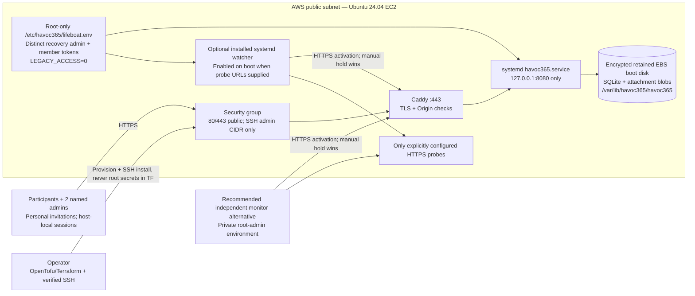
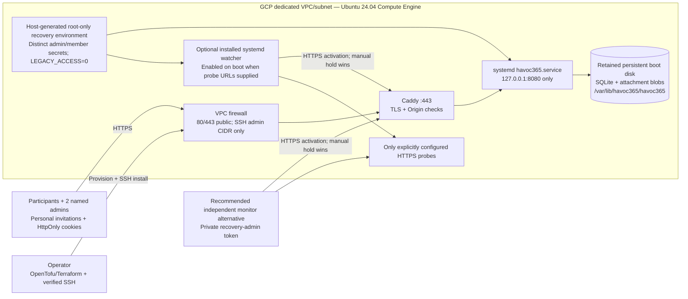
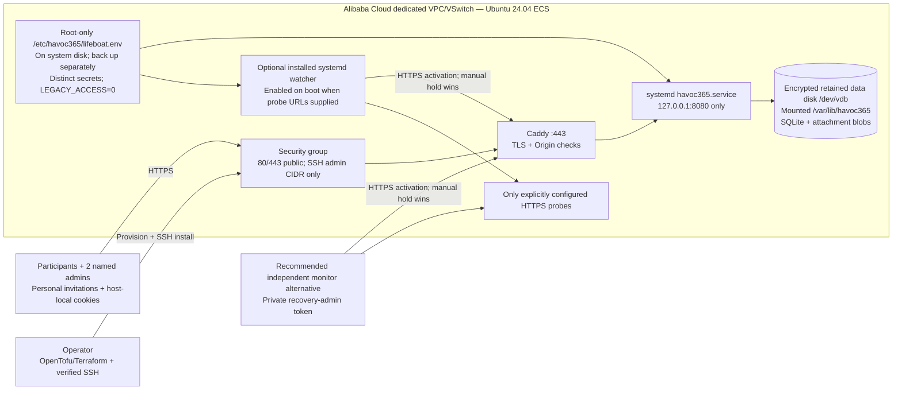
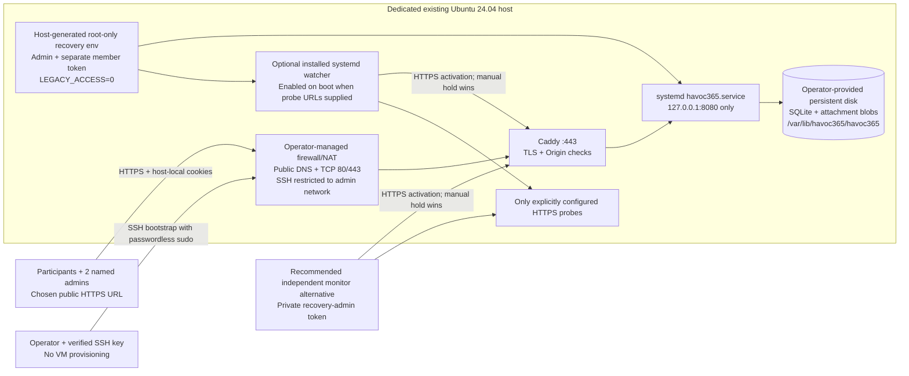
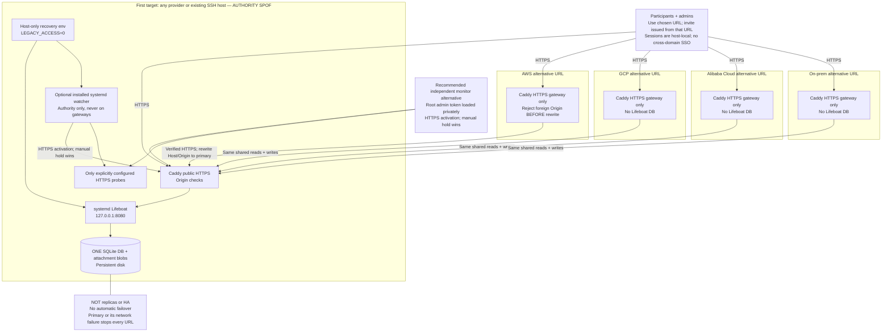
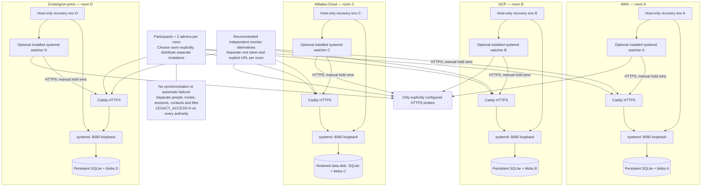

# Deployment architectures as code

These Mermaid diagrams describe the deployed topology, not a future replication design. Render this file with GitHub's Markdown viewer or a Mermaid-compatible editor. In shared mode, pick exactly one of the VM authorities below; the other targets run gateways instead. In independent mode, every target is an authority for its own room.

Explicit probe URLs enable an optional installed `havoc365-watch.service` on each authority; blank URLs mean manual-only activation, with no installed watcher. The watcher probes only the specified HTTPS endpoints, never an implicit Microsoft/DNS inventory or tenant APIs. A recommended independent monitor is shown as an alternative for failure-domain isolation: choose it instead of the host-local watcher, not alongside it. Deployment enables no paid SMS or invitation delivery. Personal credentials establish HttpOnly cookie sessions; the root recovery token stays private. Manual holds override every watcher.

## AWS authority

## GCP authority

## Alibaba Cloud authority

## Existing cloud or on-prem host

## Mixed shared-authority deployment (default)

## Independent Lifeboats

For every authority, copy consistent SQLite backups off-host and encrypt them. Attachments are stored inside SQLite, with a 25 MiB per-file and 250 MiB room quota; include that space in backup, restore and disk planning. Back up recovery environment files separately. Provider deletion protection is not a backup. See the [deployment runbook](README.md) for apply, onboarding and recovery.
